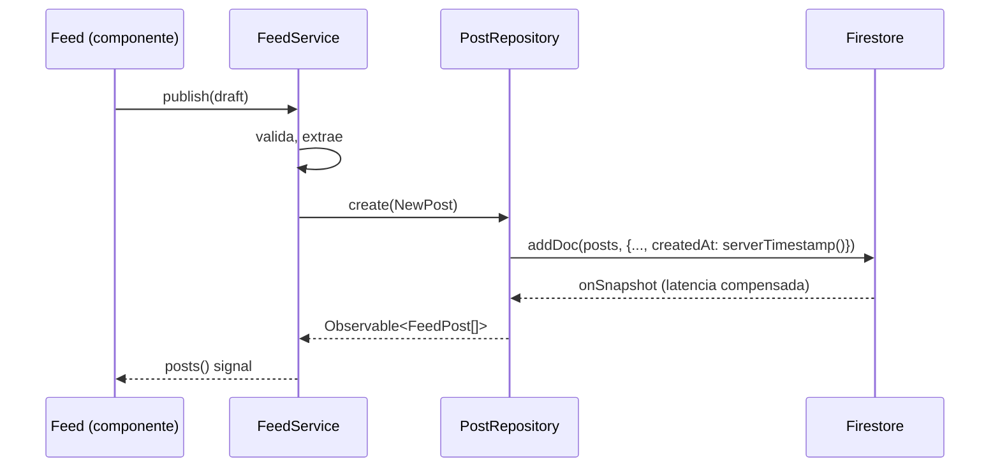

# Arquitectura

## Capas

```
features/  ──►  core/services/  ──►  core/domain/  ◄──  core/infrastructure/firebase/
(UI)            (casos de uso)       (modelos +          (adaptadores: SDK de Firebase)
                                     contratos)
```

| Capa            | Carpeta                                                     | Responsabilidad                                           | Puede importar                                   |
| --------------- | ----------------------------------------------------------- | --------------------------------------------------------- | ------------------------------------------------ |
| Presentación    | `src/app/features`, `src/app/shared`, `src/app/core/layout` | Componentes standalone, plantillas, estado de vista       | `core/services`, `core/domain` (tipos), `shared` |
| Aplicación      | `src/app/core/services`, `core/guards`                      | Orquestación, estado global con signals, reglas de la app | `core/domain`                                    |
| Dominio         | `src/app/core/domain`, `core/data`                          | Modelos, contratos (puertos), funciones puras             | Nada de Angular salvo tipos                      |
| Infraestructura | `src/app/core/infrastructure/firebase`                      | Implementaciones de los contratos con Firebase            | `core/domain`, `firebase/*`                      |

La composición se hace en `app.config.ts` con `provideFirebase(environment.firebase)`.

## Flujo de datos (ejemplo: publicar)



El estado del servidor llega como `Observable` desde el repositorio y se expone a la UI como
`Signal` (`toSignal`). Todo depende de `AuthService.user$`: al cerrar sesión los listeners se
cancelan solos gracias a `switchMap`.

## Principios SOLID aplicados

| Principio                        | Dónde                                                                                                                                                                     |
| -------------------------------- | ------------------------------------------------------------------------------------------------------------------------------------------------------------------------- |
| **S**: responsabilidad única     | `PostCard` solo presenta y emite eventos. `authErrorMessage` solo traduce errores. `createDefaultProfile` solo construye perfiles. Cada repositorio maneja una colección. |
| **O**: abierto/cerrado           | Para cambiar de backend (Supabase, REST) se crea otra implementación de los contratos y se cambia `provideFirebase()`. No se toca ninguna feature.                        |
| **L**: sustitución de Liskov     | `InMemory*Repository` y `Firebase*Repository` son intercambiables; las pruebas lo demuestran usando las primeras.                                                         |
| **I**: segregación de interfaces | Tres contratos pequeños (`AuthRepository`, `PostRepository`, `ProfileRepository`) en lugar de un "FirebaseService" gigante.                                               |
| **D**: inversión de dependencias | Servicios y componentes inyectan clases abstractas del dominio. Solo `infrastructure/firebase` importa el SDK.                                                            |

## Convenciones

- Componentes standalone, `ChangeDetectionStrategy.OnPush`, signals y control flow (`@if`, `@for`).
- App zoneless: el estado reactivo debe vivir en signals.
- Rutas lazy (`loadComponent`); guards funcionales.
- Alias: `@core/*`, `@shared/*`, `@features/*`, `@env/*`.
- Documentar con JSDoc las clases públicas de `core/`.
- Pruebas con Vitest usando `provideInMemoryBackend()`; nunca contra Firebase real.

## Cómo agregar un módulo con datos

1. Define modelos y contrato en `core/domain/<nombre>.model.ts` y `<nombre>.repository.ts`.
2. Implementa `core/infrastructure/firebase/firestore-<nombre>.repository.ts`.
3. Enlázalo en `provideFirebase()` y agrega la versión en memoria en `src/testing`.
4. Crea `core/services/<nombre>.service.ts` que exponga signals.
5. Crea la feature en `features/<nombre>/` y su ruta dentro del `Shell` en `app.routes.ts`.
6. Actualiza `firestore.rules` y el [contrato de interfaces](./contrato-de-interfaces.md).
